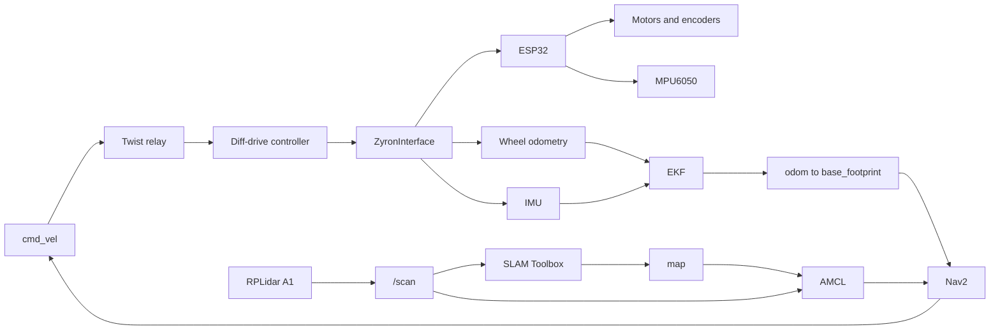

# Zyron

Zyron is an open-source differential-drive mobile robot. This repository is the software that already runs on it: motor control on an ESP32, a ROS 2 hardware interface on a Raspberry Pi, and a navigation stack that can map a room, localize, and drive to a goal.

Students use the `main` branch. It is the robot as it runs today.

## What it can already do

- **Drive from a velocity command.** A `diff_drive_controller` runs at 50 Hz. It turns a body velocity into left and right wheel speeds, and it turns encoder ticks back into wheel odometry. Configured linear speed limit is 0.7 m/s.
- **Close the loop on the motors.** The ESP32 reads quadrature encoders, runs the MPU6050, and drives two Cytron motor channels over serial at 115200 baud.
- **Fuse wheel odometry with the IMU.** An EKF (`robot_localization`) publishes a continuous `odom` → `base_footprint` transform. Wheel odometry supplies x and y. The IMU supplies yaw. The diff-drive controller does not publish that transform itself.
- **See the room.** An RPLidar A1 publishes `/scan` in `lidar_link`.
- **Build a map.** SLAM Toolbox is configured for online async, online sync, and lifelong mapping. Scan matching uses Ceres.
- **Localize on a saved map.** AMCL plus a map server load `room_map` and estimate the robot's pose in the map.
- **Navigate.** Nav2 plans with Smac 2D, follows the path with regulated pure pursuit, and runs a behavior tree that replans and recovers.

## How the pieces connect



The Raspberry Pi runs ROS 2. The ESP32 is the real-time board on the base. They talk over USB serial. The hardware launch file puts the Pi 5 USB port into raw mode before the controller manager starts, so the ESP32 is not held in reset and the link stays open.

## The robot

The model in `zyron_description` matches the base that is already built:

| | |
|---|---|
| Base | 290 mm long, 210 mm wide, 80 mm tall |
| Drive | Two wheels, 33 mm radius, 245 mm apart, at the back |
| Support | One caster at the front |
| Sensors | RPLidar A1 on a rear tower, MPU6050 in the base |
| Frames | `base_footprint`, `base_link`, `lidar_link`, `imu_link` |

Footprint used by the Nav2 costmaps: a 300 mm by 220 mm rectangle around that base.

## Packages

| Package | What students find there |
|---|---|
| `zyron_description` | URDF of the base, wheels, caster, lidar tower, and IMU |
| `zyron_control` | `ros2_control` hardware interface, serial driver, diff-drive and IMU config, local EKF |
| `zyron-firmware` | ESP32 firmware (PlatformIO, `esp32doit-devkit-v1`): motors, encoders, MPU6050 DMP |
| `zyron_perception` | RPLidar A1 launch and port config (`/dev/lidar`) |
| `zyron_slam` | SLAM Toolbox configs and launch files, plus saved maps |
| `zyron_localization` | AMCL, map server, and an RViz config for a saved map |
| `zyron_navigation` | Nav2 planner, controller, behavior tree, and a launch that starts localization and navigation together |

`zyron_control` and `zyron_description` are Apache 2.0.

## Run the robot

Build this repo in a ROS 2 workspace, source the overlay, and start the layers you need. The real robot uses `is_sim:=False`, which `hardware_interface.launch.py` already sets.

Bring up the base. This starts the robot state publisher, the serial port setup, the controller manager, the wheel and IMU broadcasters, the diff-drive controller, the Twist relay, and the EKF.

```bash
ros2 launch zyron_control hardware_interface.launch.py serial_port:=/dev/mcu
```

Start the lidar:

```bash
ros2 launch zyron_perception rplidar_a1.launch.py
```

Build a map while you drive:

```bash
ros2 launch zyron_slam zyron_slamtoolbox_online_async.launch.py use_sim_time:=false
```

Or localize on the saved room map and navigate. This starts AMCL, the map server, the planner, the controller, and the behavior tree:

```bash
ros2 launch zyron_navigation zyron_navigation.launch.py
```

Drive it by publishing `geometry_msgs/Twist` on `/cmd_vel`. The relay converts that to the stamped command the diff-drive controller expects.

The URDF can also load a Gazebo `ros2_control` plugin when `is_sim` is true. This repository does not ship a Gazebo world launch. The path above is the real robot.

## Where to look first

- Base bringup: `zyron_control/launch/hardware_interface.launch.py`
- Wheel and IMU rates: `zyron_control/config/zyron_controllers.yaml`
- EKF inputs: `zyron_control/config/local_ekf.yaml`
- Motor and encoder firmware: `zyron-firmware/src/main.cpp`
- Path follower: `zyron_navigation/config/zyron_controller.yaml`
- Global planner: `zyron_navigation/config/zyron_planner_server.yaml`
